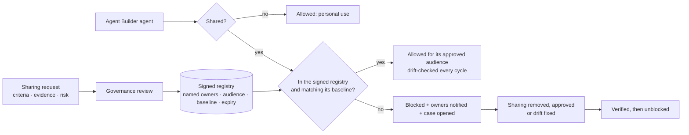

# ShareGuard for Agent Builder

[](https://github.com/OWNER/absg/actions/workflows/ci.yml)
[](LICENSE)


**Keep Agent Builder agents personal by default. Share them only when they've earned it, and keep them that way.**

Microsoft 365 Copilot Agent Builder lets anyone with Copilot build an agent in minutes. That is its strength as a personal productivity tool. It becomes a governance problem the moment one of those agents is shared: it starts answering other people's questions from its owner's instructions, knowledge and tools, with nobody having reviewed it.

ShareGuard for Agent Builder gives organisations the missing middle ground:

- every Agent Builder agent stays a personal productivity agent;
- any agent that is shared without approval is blocked automatically, and released when the sharing is removed;
- agents that need to be shared go through *your* intake process, are assessed against *your* criteria, and are recorded in a signed central registry with named owners;
- approved agents are watched continuously, so the agent you approved is the agent people keep using.

> **Status: alpha.** ShareGuard relies on Microsoft Graph APIs, some of them in preview, and on several behaviours Microsoft doesn't document. Run it in dry-run mode and work through the [pilot checklist](docs/operations-guide.md#validate-in-a-pilot-before-enforcing) before you enforce anything. The Azure deployment (Functions, SharePoint, Key Vault) is ready for a pilot; its templates and scripts haven't yet been run against a real tenant.

## Why ShareGuard is needed

### 1. You can't allow building without also allowing sharing

The control that turns Agent Builder on is the same one that lets people use agents at all, and Microsoft states that admins can't disable agent creation separately while keeping agents enabled. If you want staff to use Microsoft, partner or line-of-business agents, they can also build their own.

That is acceptable, even desirable, if those agents stay personal. Native settings can't guarantee that they do.

### 2. Native sharing controls stop *broad* sharing, but doesn't prevent sharing

Microsoft 365 lets admins restrict who can share Agent Builder agents with **the whole organisation**. Turning that off still leaves direct sharing open: users can still share with specific individuals, and the sharing dialog accepts groups and teams. A group large enough to represent the organisation defeats the restriction, and nothing reviews what was shared.

Microsoft's own comparison of the two distribution paths is the clearest statement of the gap. Submitting to the org catalog brings an admin review; direct sharing has **no review**, and changes the maker publishes are visible to shared users right away.

### 3. Approval has to mean something specific to *your* organisation

Every organisation has its own idea of an agent that's fit to share: which knowledge sources are acceptable, which data classifications, which audiences, which actions, what evidence a reviewer needs and how long an approval lasts. Native controls offer allow or block. They don't offer a place to record organisation-specific criteria, the evidence behind a decision, a risk rating, an expiry date, or the audience an agent was approved for.

### 4. What was approved can quietly change

An approval is a snapshot. Agent Builder makes it easy to change an agent's instructions, add a knowledge source or switch on a capability afterwards, and for directly shared agents those changes reach users immediately.

The most dangerous change is **adding embedded files** (uploaded knowledge) after approval:

- For SharePoint and OneDrive knowledge, the agent respects the file's existing permissions and sensitivity labels, so each user only gets answers from content they could already open.
- For uploaded files, Microsoft is explicit: any user who has access to the agent has access to the information in the file. Purview Information Barriers aren't enforced on embedded files either.

An agent approved because it only grounded on a permission-trimmed SharePoint site can therefore, with one upload, start serving a confidential document to its entire audience. The original document's permissions no longer apply. ShareGuard treats that as drift and blocks the agent until it's put right.

### 5. Ownership and lifecycle need policy, not just tools

Microsoft has added important building blocks: Agent Builder agents now support multiple owners with equal edit rights; admins can reassign, block and delete agents in the Agent 365 registry; and agent management rules can reassign ownerless Agent Builder agents to a manager and block ownerless agents without usage.

What's still left to each organisation is the policy around them:

- who must be a named owner of an agent that's shared, and what happens when they leave;
- when an unused agent is retired, not only when it's ownerless;
- whether adding a co-owner (who gets full edit and share rights) is itself a change that needs approval;
- tying all of this to the approval record, with an audit trail.

### 6. Sprawl creates risks nobody has listed yet

Thousands of unreviewed personal agents means instructions nobody has read, knowledge copied out of its source system, duplicated and abandoned agents, and agents that outlive their owners' roles. You don't need to predict every risk if the operating model is simple: **personal by default, shared only when approved, approved only while compliant.**

## How ShareGuard closes the gaps

| Need | Native Microsoft 365 controls | What ShareGuard adds | Status |
| --- | --- | --- | --- |
| Keep agents personal | Restrict org-wide sharing; direct sharing with people and groups stays open | Detects any sharing (people, groups, org-wide) and blocks the agent tenant-wide until it's removed or approved | Available |
| Fix it without a ticket | Owner removes sharing manually | Notice email explains why; the owner can confirm and ShareGuard removes the sharing for them, verifies it, then unblocks | Available |
| Intake for sharing requests | Org catalog submission (admin review for catalog publication only) | A sharing request process with your criteria, evidence, risk rating, audience and expiry, reviewed by your governance team | Available: SharePoint request list, Power Automate approval, and a signer that refuses incomplete approvals (or the `--registry-draft` / `--registry-sign` commands) |
| Central registry of approved agents | Agent registry lists agents; no record of *why* one was approved | Signed registry: approval criteria and evidence, risk rating, approver, expiry, approved audience, configuration baseline, named owners | Available |
| Approved audience only | — | Sharing beyond the approved audience is drift and blocks the agent | Available |
| Configuration drift after approval | Changes go live for shared users immediately | Every cycle compares instructions, knowledge sources, capabilities, actions and embedded files with the approved baseline; drift blocks the agent and notifies the owner; it's released once it matches again | Available |
| Embedded knowledge added later | Embedded files bypass source permissions | Specific drift rule; fails closed if the definition can't be read | Available |
| Multiple owners | Supported natively, all with equal rights | Registry records every named owner; notices go to all of them; adding an unregistered co-owner is treated as a change needing approval | Available (co-owner detection needs owner data from the API or an owner map) |
| Retire inactive agents | Rule to block ownerless agents without usage | Organisation-defined inactivity period for every Agent Builder agent: owners get a notice (for example a month ahead) and a reminder, then the agent is blocked, archived to a restricted SharePoint site and deleted from Microsoft 365. Owners can reactivate it until it's deleted. | Available |
| Ownerless agents | Rule to reassign ownerless Agent Builder agents to a manager | Detects agents whose owners have all left; reports, reassigns to a manager or blocks, by policy; approved agents need a registered, active owner | Available |
| Evidence for auditors | Admin centre activity | Tamper-evident, hash-chained audit trail of every detection, decision, email, acknowledgement and action, linked by case ID | Available |
| Safe operation | — | Dry run, circuit breaker, fail-closed registry, never touches agents an admin blocked | Available |

We looked for Microsoft and partner solutions before building ShareGuard. Partner tools and Microsoft's own registry cover inventory, reporting and manual admin actions well. In our review we didn't find one that enforces "personal by default" for Agent Builder, ties sharing to an organisation-specific approval record, and blocks on drift after approval. If you know of one, please open an issue so we can reference it.

## How it works



1. **Watch.** ShareGuard reads every Agent Builder agent through the Package Management API, including its full definition.
2. **Decide.** Unshared agents are left alone. Shared agents must have a valid, unexpired, correctly signed registry entry, be shared only with the approved audience, and still match the approved configuration.
3. **Act.** Anything else is blocked tenant-wide, the owner is told exactly why and how to fix it, and a case is opened.
4. **Release.** When sharing is removed, the drift is put right or governance approves the agent, ShareGuard verifies it and unblocks the agent.
5. **Prove.** Every step is written to a hash-chained audit trail that can be verified independently.

## What you need to decide

ShareGuard enforces your policy; it doesn't invent it. Before a pilot, agree the following, then record it in the parameters file (see the [customisation guide](docs/customisation.md)):

- the sharing criteria and evidence reviewers will require (the examples ship with knowledge-source, embedded-file, data-sensitivity, audience and actions criteria);
- who reviews, and how long an approval lasts;
- which drift is tolerated (for example new SharePoint sites within an approved hub) and which always blocks (embedded files);
- the inactivity period, how much notice owners get, how long a retired agent waits before it's archived, and who deletes it; and who owns ownerless agents;
- how you'll communicate the change to makers. Most of ShareGuard's value comes from makers knowing that personal agents are welcome and shared ones have a clear path.

## Requirements

- A Microsoft 365 tenant with **Microsoft Agent 365** licensing (the Package Management API requires it).
- An Entra app registration (or managed identity) with `CopilotPackages.ReadWrite.All`. Email features also need `Mail.Send` (scope it to one mailbox) and `User.Read.All`.
- Optional: a delegated service account for removing sharing on an owner's behalf, because Microsoft documents that API as delegated-only.
- Python 3.10 or later, or the Azure deployment (Azure Functions, Python 3.11).

[docs/operations-guide.md](docs/operations-guide.md#prerequisites) lists every permission and why it's needed.

## Quick start

Two ways to run it:

- **Azure (recommended for production):** two Function apps with managed identities, state and audit in SharePoint, keys in Key Vault. Follow the [Azure deployment guide](docs/azure-deployment.md): `azure/deploy.sh` plus four provisioning scripts.
- **Standalone daemon** with local files, for evaluation or a container:

```bash
pip install git+https://github.com/OWNER/absg.git      # or: git clone … && pip install -e .

cp examples/config.example.json config.json            # edit tenant, app and options
export ABSG_TENANT_ID=… ABSG_CLIENT_ID=… ABSG_CERT_PATH=… ABSG_CERT_THUMBPRINT=…

absg --config config.json --dry-run --once             # report what would happen, change nothing
absg --config config.json                              # run as a daemon
```

Useful commands:

| Command | Purpose |
| --- | --- |
| `absg --verify-audit FILE` | Verify the audit trail's hash chain |
| `absg --audit-history FILE --case ID` | Everything about one block, from detection to restoration |
| `absg --config C --verify-audit-store` | Verify the audit chain where it's stored (local file or SharePoint) |
| `absg --registry-keygen DIR [--algorithm es256\|rs256]` | Create a registry signing key pair for the file-based workflow (Ed25519 by default). The Azure deployment signs with a Key Vault HSM key instead. |
| `absg --registry-export-jwk PEM` | Print an RS256 key as a JWK |
| `absg --config C --registry-draft PACKAGE_ID` | Draft a registry entry with a baseline taken from the live agent |
| `absg --registry-sign ENTRY --key KEY` | Sign a completed entry (refuses unfinished placeholders) |
| `absg --config C --registry-validate` | Check every approved agent against its approval |
| `absg --config C --login-delegated` | One-off device-code sign-in for the sharing-removal account |

## Documentation

- [Operations guide](docs/operations-guide.md): behaviour, configuration, registry, emails, acknowledgement flow, audit trail and pilot checklist
- [Customisation guide](docs/customisation.md): one place for names, schedules, lifecycle periods, approval criteria, email wording and forms
- [Azure deployment guide](docs/azure-deployment.md): step-by-step deployment to Azure Functions with SharePoint, Exchange Online and Key Vault, including the acknowledgement and review flows
- [Deployment architecture for Microsoft 365](docs/deployment-architecture.md): the design behind it, inside your tenant boundary
- [Naming convention](docs/naming-convention.md)
- [Example configuration](examples/config.example.json) and [example registry entry](examples/registry.example.json)

## Security

ShareGuard holds powerful permissions over your tenant's agents. Read [SECURITY.md](SECURITY.md) for how to report vulnerabilities, and the [deployment architecture](docs/deployment-architecture.md) for least-privilege guidance. Please don't open public issues for security problems.

## Contributing

Contributions are welcome. See [CONTRIBUTING.md](CONTRIBUTING.md) and the [Code of Conduct](CODE_OF_CONDUCT.md).

## References

The gaps described above are based on Microsoft's documentation as of November 2026. Microsoft is changing this area quickly; please open an issue if something here is out of date.

- [Share and manage agents built in Agent Builder](https://learn.microsoft.com/microsoft-365/copilot/extensibility/agent-builder-share-manage-agents): multiple owners, org-wide sharing control, direct sharing, creation can't be disabled separately
- [Submit agents from Agent Builder to your org catalog](https://learn.microsoft.com/microsoft-365/copilot/extensibility/agent-builder-submit-to-org-catalog): sharing has no review; catalog submission does
- [Add knowledge sources in Agent Builder](https://learn.microsoft.com/microsoft-365/copilot/extensibility/agent-builder-add-knowledge): SharePoint permissions respected; embedded files available to anyone with access to the agent; Information Barriers not supported on embedded files
- [Agent settings in the Microsoft 365 admin center](https://learn.microsoft.com/microsoft-agent-365/admin/agent-settings): sharing settings and agent management rules for ownerless agents
- [Governance and lifecycle actions for agents](https://learn.microsoft.com/microsoft-365/admin/manage/agent-actions): block, unblock, delete and reassign
- [Package Management API](https://learn.microsoft.com/microsoft-365/copilot/extensibility/api/admin-settings/package/overview): the API ShareGuard uses

## Licence

Licensed under the [Apache License, Version 2.0](LICENSE). See [NOTICE](NOTICE).

## Disclaimer

This is an independent open-source project. It isn't affiliated with, endorsed by or supported by Microsoft. Microsoft, Microsoft 365, Copilot, Entra, Exchange, SharePoint and Azure are trademarks of the Microsoft group of companies. Use ShareGuard at your own risk, and test it in a non-production tenant first. It changes the availability of agents in your organisation.
