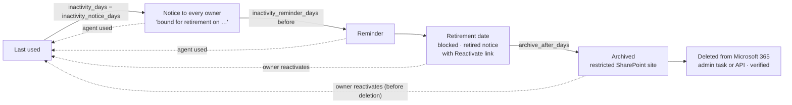

# Customisation guide

Everything an organisation is likely to change about ShareGuard for Agent Builder is in one place: **the parameters file**. It's a copy of [`azure/infra/main.parameters.example.json`](../azure/infra/main.parameters.example.json), kept outside the repository (for example `~/absg/main.parameters.prod.json`, one per environment). Each part of the deployment reads it:

| Reads the parameters file | How |
| --- | --- |
| Azure resources | `azure/deploy.sh <rg> <parameters file>` passes it to the Bicep template |
| Guard and signer configuration | The template turns it into each Function app's `ABSG_CONFIG_JSON` |
| Entra ID, Exchange Online and SharePoint objects | Every script in `azure/scripts` takes `-ParametersFile <file>` |

Email wording lives in a second place, a folder of [email templates](#emails). The standalone daemon (no Azure) uses `config.json` instead ([`examples/config.example.json`](../examples/config.example.json)). Its keys are the same as those in the `lifecycle`, `email` and `guardSettings` objects below.

> **Decide names before the first deployment.** Renaming an Azure resource later creates a new resource, and a renamed SharePoint list starts empty. Everything else in this guide can be changed at any time: edit the parameters file and run `azure/deploy.sh` again with `initialiseSecrets: false`.

## Where to change what

| To change | Parameters file key | Section |
| --- | --- | --- |
| Names of Azure resources, identities, Key Vault objects | `naming` | [Naming](#naming) |
| Names of Entra apps, Exchange objects, groups | `naming` | [Naming](#naming) |
| Names of SharePoint lists, libraries and folders | `sharePointNames` | [Naming](#naming) |
| Which sites are used | `operationsSiteId`, `registrySiteId`, `archiveSiteId` | [Naming](#naming) |
| How often the guard, signer and audit check run | `guardSchedule`, `signerSchedule`, `auditCheckSchedule` | [Schedules](#schedules) |
| Inactivity period, notice, reminder, archive, deletion | `lifecycle` | [Lifecycle](#lifecycle) |
| Ownerless agents | `lifecycle.ownerless_action` | [Lifecycle](#lifecycle) |
| Sharing criteria reviewers score, longest approval | `approvalCriteria`, `maxApprovalDays` | [Approval criteria](#approval-criteria) |
| Email branding, sender, policy link, helpdesk | `email`, `mailSender`, `policyUrl`, `helpdeskContact` | [Emails](#emails) |
| Email wording | Template files | [Emails](#emails) |
| Acknowledgement form and flows | `ackFormUrl` | [Forms and flows](#forms-and-flows) |
| Who gets admin alerts and Azure alerts | `adminEmails`, `alertEmail`, `notRunningAlertMinutes` | [Alerts](#alerts) |
| Anything else in the guard configuration | `guardSettings` | [Other settings](#other-settings) |

## Naming

### Azure resources, Key Vault objects and Entra and Exchange objects (`naming`)

Set `naming.workload` to change the code in every default name, for example `"workload": "agentguard"` gives `func-agentguard-guard-prod`. You can also override any single name. Keys you leave out keep their default (`<w>` = workload, default `absg`; `<env>` = `env`).

| Key | Default | What it is |
| --- | --- | --- |
| `guardIdentity`, `signerIdentity` | `id-<w>-guard-<env>`, `id-<w>-signer-<env>` | User-assigned managed identities. Their service principals have the same names in Entra ID. |
| `guardApp`, `signerApp` | `func-<w>-guard-<env>`, `func-<w>-signer-<env>` | Function apps (globally unique host names) |
| `plan` | `asp-<w>-<env>` | Flex Consumption plan |
| `keyVault` | `kv-<w>-<env>-<unique>` (24 characters at most) | Key Vault (globally unique) |
| `storage` | `st<w><env><unique>` (24 characters at most, lower-case letters and digits only) | Functions runtime storage |
| `vnet`, `functionSubnet`, `endpointSubnet` | `vnet-<w>-<env>`, `snet-func`, `snet-pe` | Network |
| `natGateway`, `natPublicIp` | `ng-<w>-<env>`, `pip-nat-<w>-<env>` | Outbound IP for Conditional Access |
| `logAnalytics`, `appInsights`, `actionGroup` | `log-<w>-<env>`, `appi-<w>-<env>`, `ag-<w>-<env>` | Monitoring |
| `registryKey`, `ackSecret`, `delegatedCacheSecret` | `registry-signing-key`, `ack-token-hmac-key`, `delegated-token-cache` | Key Vault key and secrets |
| `delegatedClientApp` | `ShareGuard for Agent Builder - sharing removal` | Entra app registration for the sharing-removal account (scripts) |
| `exchangeServicePrincipal`, `mailboxScope` | `<w> guard (<env>)`, `<w> sender mailbox (<env>)` | Exchange Online service principal and management scope (scripts) |
| `mailboxDisplayName` | `ShareGuard for Agent Builder` | Display name of the shared sender mailbox, if the script creates it |
| `reviewersGroup`, `operatorsGroup` | `ABSG - Governance Reviewers`, `ABSG - Operators` | Entra groups you create; the SharePoint script grants the reviewers group access |

The resource group, the service accounts (`svc-absg@`, `svc-absg-flow@`), the shared mailbox address (`mailSender`) and the SharePoint sites are created by you, so name them as you like and put them in the parameters file. [naming-convention.md](naming-convention.md) describes the default pattern.

### SharePoint (`sharePointNames`)

| Key | Default | Site |
| --- | --- | --- |
| `stateLibrary` | `ABSG State` | Operations |
| `auditLibrary` | `ABSG Audit` | Operations |
| `acknowledgementsList` | `Agent Acknowledgements` | Operations |
| `templatesFolder` | *(none)* | Operations, a folder in the state library for customised email templates |
| `registryList` | `Approved Agents` | Registry |
| `requestsList` | `Agent Sharing Requests` | Registry |
| `signerAuditLibrary` | `ABSG Signer Audit` | Registry |
| `archiveLibrary` | `Retired Agents` | Archive site (`archiveSiteId`), or the Operations site if that's empty |

`Provision-AbsgSharePoint.ps1` creates the lists with these names, and the guard and signer look for the same names, so change them only here. **Column names are fixed**: ShareGuard reads them by name. You can change the *display* name of any column in SharePoint, and its internal name stays the same.

Use a **separate, restricted site for the archive** (`archiveSiteId`, provisioned with `-ArchiveSiteUrl`) if archived agent definitions need tighter access or longer retention than operational data. Only the guard (write) and the people you add can see it.

## Schedules

NCRONTAB expressions (six fields, seconds first, UTC):

| Parameter | Default | Runs |
| --- | --- | --- |
| `guardSchedule` | `0 */5 * * * *` (every 5 minutes) | The guard cycle: detection, blocks, acknowledgements, lifecycle |
| `signerSchedule` | `0 */15 * * * *` | The registry signer |
| `auditCheckSchedule` | `0 30 2 * * *` (02:30 UTC) | The audit chain check |
| `notRunningAlertMinutes` | `20` | Alert when no guard cycle completed in this time; keep it at about four times the guard interval |

A shared agent stays usable until the next cycle, so a shorter guard interval shortens the exposure. Five minutes is a good balance with Graph throttling; don't go below two. Lifecycle steps (notice, retirement, archive, deletion) run inside the guard cycle, so they need no schedule of their own. Standalone daemon: `poll_interval_seconds`.

## Lifecycle

### Inactive agents: notice, retirement, archive, deletion



With the example settings (90, 30, 7, 30), the timeline after the last use is:

| Day | What happens | Audit event |
| --- | --- | --- |
| 60 | Owners told the agent is **bound for retirement** on day 90 | `inactivity_warning` |
| 83 | Reminder: 7 days left | `inactivity_reminder` |
| 90 | Agent is **blocked** (retired). Owners get a notice with a "Reactivate my agent" link. | `block` (`blockType: retired`) |
| 120 | Agent definition **archived** to the restricted site; owners told | `agent_archived` |
| 120 | Admins asked to **delete** it (or it's deleted by API); reminders every 7 days | `deletion_requested`, `deletion_reminder` |
| when deleted | ShareGuard sees it's gone and records it | `agent_deleted` |

Any use before retirement cancels the countdown (`inactivity_cleared`). An owner can reactivate a retired agent at any time **until it's deleted**. If that happens after the deletion request, admins get a "Don't delete" alert (`deletion_cancelled`).

| Key (`lifecycle`) | Default | Meaning |
| --- | --- | --- |
| `inactivity_days` | *off* | Days without use before an agent counts as inactive and is retired. Last use is the latest of `lastUsedDateTime`, `lastModifiedDateTime`, creation, and the last reactivation. |
| `inactivity_notice_days` | `30` | How far ahead owners are told. Retirement is **never sooner** than this after the notice, so switching the policy on gives every existing inactive agent the full notice. |
| `inactivity_reminder_days` | `7` | A reminder this many days before retirement; `0` = none |
| `inactivity_applies_to_approved` | `true` | Also retire registry-approved (shared) agents |
| `archive_after_days` | `30` | Days a retired agent stays blocked, and can be reactivated, before it's archived; `0` = archive straight away; `null` = never archive (stays blocked) |
| `archive_retention_label` | *(none)* | Purview retention label applied to every archived file. A record label is fine: archive files are never rewritten. |
| `archive_notify_owners` | `true` | Email owners when their agent is archived |
| `deletion_mode` | `manual` | `manual`: admins delete it in the Microsoft 365 admin centre, and ShareGuard sends the request and reminders and confirms the deletion. `api`: experimental; see below. `none`: archive only; the agent stays blocked. |
| `deletion_reminder_days` | `7` | Days between reminders while a deletion is outstanding |
| `deletion_api_path` | `/copilot/admin/catalog/packages/{id}` | `api` mode only |

**What's archived.** Each agent gets a folder `<year>/<packageId>/` in the archive library:
- `agent.json`: the full package detail from the Package Management API, including the declarative agent definition (instructions, knowledge sources, capabilities, actions);
- `manifest.json`: owners (names and UPNs), last activity, retirement and archive dates, the case ID that links it to the audit trail, any registry approval, the SHA-256 of `agent.json`;
- `status-deleted.json` or `status-reactivated.json`, added later.

Files uploaded to the agent as knowledge (embedded files) are stored in its SharePoint Embedded container. They are **not** copied: the manifest lists them where the definition names them. If you need them kept, apply a Purview retention policy to those containers before deletion.

**Deletion.** Microsoft's Package Management API has no documented delete operation, so the default is an admin task: Microsoft 365 admin centre → **Agents** → **All agents** → select the agent → **Delete agent**. Microsoft keeps deleted agents for 30 days (soft delete), and an admin can restore one in that time. `deletion_mode: "api"` sends an undocumented `DELETE` request, using the sharing-removal account if one is configured. If the call fails, or the agent is still listed after `deletion_reminder_days`, ShareGuard falls back to the admin task. Test it on a pilot agent before you rely on it.

The circuit breaker (`max_blocks_per_cycle`) also limits retirements, so a newly enabled policy retires agents gradually.

### Ownerless agents

| Key (`lifecycle`) | Default | Meaning |
| --- | --- | --- |
| `owner_status_checks` | `true` | Check owners' accounts each cycle; a deleted or disabled account is inactive |
| `ownerless_action` | `report` | When every owner is inactive: `report` (admin alert), `reassign_to_manager` (to a disabled owner's active manager), or `block` (until an active owner is assigned) |

See [Ownership and lifecycle](operations-guide.md#ownership-and-lifecycle) in the operations guide for the details.

## Approval criteria

The criteria reviewers must score before an agent can be shared are yours to define. Each one is a **Pass / Fail / N/A** choice column in the requests list. The signer refuses to register an agent unless every criterion is Pass or N/A.

```json
"approvalCriteria": { "value": [
  { "column": "KS01", "id": "KS-01", "description": "Knowledge sources limited to approved SharePoint sites" },
  { "column": "PRIV01", "id": "PRIV-01", "description": "Privacy impact assessment completed" }
] }
```

- `column`: the column's internal name (letters and digits). `Provision-AbsgSharePoint.ps1` creates it. Columns you remove from the list stay in SharePoint; delete them by hand if you want.
- `id` and `description`: recorded in the signed registry entry and shown in the audit trail.
- `maxApprovalDays` (default 365): the longest expiry a reviewer may set.

Leave `approvalCriteria` empty to use the five defaults shown in the example file. Changing the criteria doesn't affect agents already approved: their signed entries keep the criteria they were approved under.

## Emails

### Branding and sender

| Key | Default | Meaning |
| --- | --- | --- |
| `mailSender` | — | Shared mailbox the email comes from (scoped by `Grant-AbsgMailbox.ps1`) |
| `policyUrl` | *(none)* | "Read the Copilot agent policy" link in every email |
| `helpdeskContact` | `the IT service desk` | Used in the footer and in "contact …" sentences |
| `email.email_brand_name` | `ShareGuard for Agent Builder` | Service name in the footer and admin alert subjects |
| `email.email_subject_prefix` | *(none)* | Added in front of every subject, for example `[IT]` |
| `email.email_footer` | *(none)* | Replaces "Need help? Contact …" in the footer |
| `email.email_button_colour` | `#0f6cbd` | Colour of the action buttons |

Every message carries the header `X-ABSG: <template>`. Use it in an Exchange transport rule to add a "genuine IT message" banner.

### Wording: templates

Each email is a template file. To change one:

```bash
absg --export-email-templates my-templates   # the defaults, one file per email
# edit the files you want to change; delete the rest (missing ones use the default)
absg --check-email-templates my-templates    # unknown templates or placeholders → exit 1
absg --preview-emails preview --templates my-templates --config config.json
```

`--preview-emails` renders every email with sample data into `preview/`, so you can review them in a browser. The first line of a file is `Subject: …`, and the rest is the HTML body. Placeholders look like `{{agent_name}}`.

Put the finished files in the folder named by `sharePointNames.templatesFolder`, inside the state library on the Operations site (Azure), or in `email_templates_dir` (standalone). The Azure guard loads them at the start of every cycle; the standalone daemon loads them when it starts. **A template with a problem stops the guard**, which fails safe: owners never get a half-filled email. Run `--check-email-templates` before uploading.

| Template file | Sent when | Placeholders (besides the common ones) |
| --- | --- | --- |
| `layout.html` | Wraps every email | `content_html` (required), `footer_html` |
| `welcome.html` | An owner's first agent | — |
| `share_notice.html` | Blocked for sharing | `shared_with_html`, `ack_url`, `ack_expires`, `ack_button_html`, `ack_expiry_html` |
| `drift_notice.html` | Approved agent blocked for drift | `violations_html`, `request_id`, `request_ref_html`, `ack_url`, `ack_expires`, `option_unshare_html` |
| `restored.html`, or a variant: `restored.unshared.html`, `.approved`, `.drift_fixed`, `.reactivated` | Unblocked | `restore_reason` |
| `inactivity_warning.html` | Notice: bound for retirement | `last_activity`, `retire_on`, `inactivity_days`, `notice_days`, `days_left`, `after_retirement_html` |
| `inactivity_warning.reminder.html` | The reminder | Same as the notice |
| `retired_notice.html` | Retired (blocked) | `inactivity_days`, `retired_on`, `archive_on`, `ack_url`, `ack_expires`, `ack_button_html`, `after_retirement_html` |
| `archived_notice.html` | Archived | `archived_on`, `archive_reference`, `deletion_html` |
| `ownership_transferred.html` | Reassigned to a manager | `previous_owner` |
| `admin_alert.html` | Alerts to `adminEmails` | `subject`, `details_html` |

Common placeholders: `owner_name`, `agent_name`, `agent_id`, `brand_name`, `policy_url`, `policy_link_html`, `helpdesk`. Values are HTML-escaped. Placeholders ending in `_html` are inserted as they are, because ShareGuard builds them (lists, buttons, tables). A variant file (for example `restored.reactivated.html`) is used if it exists, otherwise the base file, otherwise the default.

## Forms and flows

These are set up by hand in Microsoft Forms and Power Automate ([Azure deployment guide](azure-deployment.md#step-5-acknowledgement-form-and-flow)). You're free to change:

- **The acknowledgement form**: its title, wording, theme and confirmation message, and any extra questions. Keep one text question for the token, pre-filled from the link. `ackFormUrl` is the pre-filled link with `{token}` where the token goes. To change the button text in the email, edit the `ack_button_html` sentence in the templates.
- **The acknowledgement flow**: anything, as long as it creates an item in the acknowledgements list with `Token`, `ResponderUpn` and `Status = New`. The guard checks everything else.
- **The intake form and review flow**: who reviews, how many approval stages, reminders and escalation, and extra columns for your own use. The signer needs only `PackageId`, `Owners`, `AudienceGroupIds`, `ExpiresAt`, the criteria columns, `RiskRating`, `ApprovedBy` and `Status = Approved`.

## Alerts

| Parameter | Meaning |
| --- | --- |
| `adminEmails` | Admin alerts from the guard: owner unknown, removal failed, ownerless agents, ready for deletion, archive failed |
| `alertEmail` | Azure Monitor alerts: not running, audit integrity failure, circuit breaker, registry tampering, archive failure, delegated sign-in expired |
| `notRunningAlertMinutes` | See [Schedules](#schedules) |

To send events to Teams or a SOC instead, set `guardSettings.notify_webhook_url` (blocked, unblocked, archived, deleted, circuit breaker, audit integrity).

## Other settings

Any guard configuration key can go in `guardSettings`. It's applied last, so it wins over the objects above. Common ones:

| Key | Default | Meaning |
| --- | --- | --- |
| `max_blocks_per_cycle` | `25` | Circuit breaker |
| `exempt_ids` | `[]` | Agents allowed to be shared without a registry entry (use sparingly) |
| `owner_fields` | `[]` | Where the package detail holds owners, once you've confirmed it in the pilot |
| `ignore_principal_ids` | `[]` | Principals that never count as sharing |
| `ack_token_ttl_hours` | `168` | How long acknowledgement and reactivation links stay valid |
| `drift_fail_closed` | `true` | Block an approved agent whose definition can't be read |

The [operations guide](operations-guide.md) and [`examples/config.example.json`](../examples/config.example.json) describe every setting.
