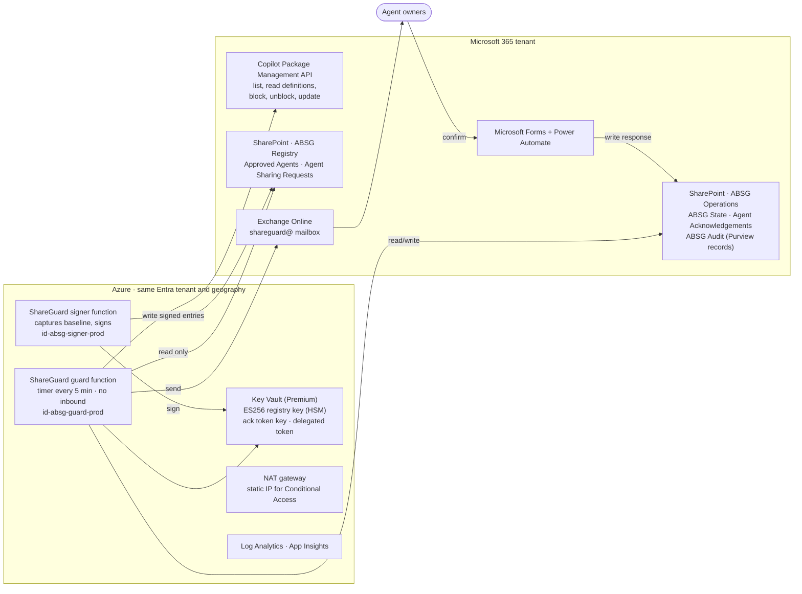
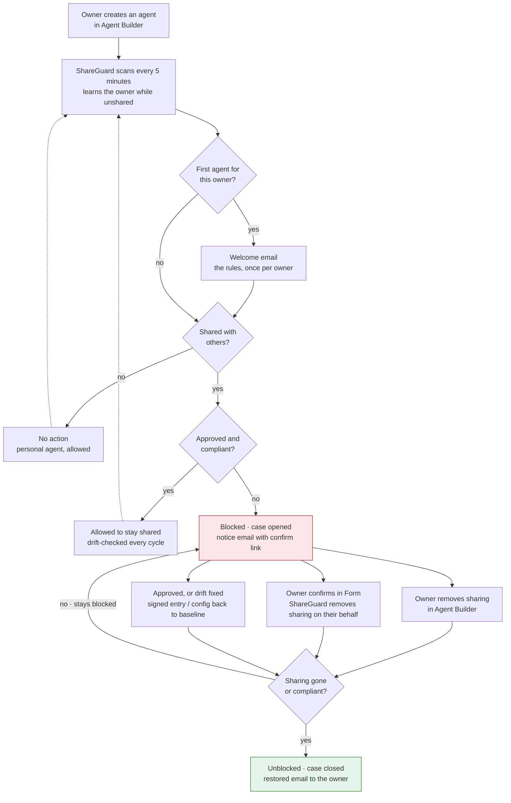
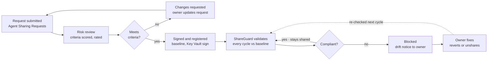

# Deployment architecture for Microsoft 365

> Status: **implemented, pilot-ready.** The adapters described here are in the code (see [code changes](#code-changes-for-this-deployment)). Step-by-step deployment is in the [Azure deployment guide](azure-deployment.md); the Bicep template is in `azure/infra` and the provisioning scripts in `azure/scripts`.

## Summary

Run ShareGuard for Agent Builder as a timer-triggered Azure Function in the organisation's own Azure subscription. The subscription sits under the same Entra tenant and in the same region as Microsoft 365. Keep all of ShareGuard's data in SharePoint Online, and send all notifications through Exchange Online. Nothing exposes an inbound endpoint, and no secret is stored in code or configuration.

Key decisions:

- **Compute: Azure Functions (Flex Consumption, Python) on a timer.** Microsoft 365 can't host a Python daemon. Azure in the same tenant is the closest boundary-preserving option. Deploy to the same geography as the M365 tenant.
- **Identity: user-assigned managed identities.** They hold the Microsoft Graph application permissions, so there are no client secrets or certificates to rotate.
- **Data: two SharePoint Online sites.** An *ABSG Registry* site is owned by governance, and the guard can only read it. An *ABSG Operations* site holds the guard's state, acknowledgements and audit log, with the audit files kept as Purview records.
- **Notifications: a shared mailbox in Exchange Online.** Graph `Mail.Send` is restricted to that one mailbox with RBAC for Applications.
- **Owner acknowledgement: a Microsoft Form plus a Power Automate flow.** This replaces the built-in web endpoint. Forms records the responder's identity, so no reverse proxy or public URL is needed.
- **Registry signing: a Key Vault HSM key, used by a separate signer function.** Key Vault doesn't support Ed25519, so in this deployment the signature scheme moves to ECDSA P-256 (ES256). The guard holds only the public key.
- **Delegated blocking and sharing removal: a dedicated service account.** Its refresh token is kept in Key Vault, and Conditional Access confines its sign-ins to the function's fixed outbound IP address.

See also the [naming convention](naming-convention.md).

## Architecture overview

The guard reads and enforces through the Package Management API, reads the Registry site, writes its state and audit log to the Operations site, and sends notices from Exchange Online. The signer is the only identity that writes approved entries, and only after signing them with the Key Vault key. Owners never reach Azure: they get email and confirm in Microsoft Forms.

## ShareGuard workflow: creation, blocking, unblocking

Every cycle, each agent is checked from the top: a personal agent is left alone, and an approved, compliant agent may stay shared. Anything else is blocked until one of three paths resolves it, and ShareGuard checks the fix itself on its next cycle before it unblocks. If removal on the owner's behalf can't be verified after the allowed attempts, the case goes to admins instead.

## Data stores in SharePoint Online

| Store (today) | SharePoint location | Shape | Guard access | Protection |
| --- | --- | --- | --- | --- |
| Registry (`registry.json`) | **ABSG Registry** · list *Approved Agents* | One item per agent: identity, status, approval, criteria, allowed principals, policy, baseline, signature | Read only (`Sites.Selected`, read) | Every entry signed; versioning on; only the signer identity can write |
| Sharing requests (new) | ABSG Registry · list *Agent Sharing Requests* | One item per request: agent, justification, audience, risk answers, reviewer decisions | None | Users create their own items; reviewers edit |
| State (`absg_state.json`) | **ABSG Operations** · library *ABSG State* · `state.json` | One JSON file, written with an eTag check (`If-Match`) | Read/write | Versioning keeps every previous state |
| Acknowledgements (`absg_acks.json`) | ABSG Operations · list *Agent Acknowledgements* | One item per acknowledgement: case ID, package ID, signed token, responder | Read/write | Written only by the Forms flow account |
| Audit trail (`absg_audit.jsonl`) | ABSG Operations · library *ABSG Audit* · one JSONL file per day | Hash-chained records; each day's file starts from the previous file's last hash | Create files; no edit or delete | Purview retention label declares each closed file a **record** |
| Owner map, email templates | ABSG Operations · library *ABSG State* · `owner-map.json`, `templates/` | JSON file; one HTML file per customised email | Read only (in practice) | Library versioning; templates are checked before use |
| Archive of retired agents | **ABSG Archive** (restricted; or ABSG Operations) · library *Retired Agents* · `<year>/<packageId>/` | `agent.json` (full definition), `manifest.json`, status files; never rewritten | Create files | Purview retention label (record) on every file |
| Secrets | **Azure Key Vault** | Delegated token cache, ack token key, registry signing key | Get secrets; verify only | RBAC, private endpoint, purge protection |

SharePoint has no append operation. The guard buffers a cycle's audit records and rewrites that day's file, then closes and labels it at the end of the day. Once a file is labelled as a record, neither the guard nor a site owner can change or delete it before its retention period ends. Use a *regulatory record* label if it must be locked even from admins.

## Notifications on Exchange Online

1. **Create a shared mailbox**, for example `shareguard@contoso.com`, with the display name "ShareGuard for Agent Builder". Block direct sign-in to it.
2. **Don't grant `Mail.Send` in Entra ID.** A tenant-wide grant lets the app send as *any* mailbox.
3. **Grant it through [RBAC for Applications](https://learn.microsoft.com/exchange/permissions-exo/application-rbac)** instead: create the service principal pointer in Exchange Online (`New-ServicePrincipal`), a management scope matching only the shared mailbox, and an `Application Mail.Send` role assignment with that scope. Managed identities are supported. Verify with `Test-ServicePrincipalAuthorization`.
4. **Keep sent copies** (`saveToSentItems: true`), so the mailbox's Sent Items holds a Microsoft-side copy of every notice.
5. **Mail flow.** ShareGuard stamps every message with an `X-ABSG` header (its value is the template name). Add a transport rule that matches it and adds a banner telling users it's a legitimate IT message.

## Owner acknowledgement without a web endpoint

1. **The notice email links to a pre-filled Microsoft Form.** The case ID and the signed token are pre-filled. The form is restricted to people in the organisation and records each responder's name.
2. **A Power Automate cloud flow** ("When a new response is submitted") copies each response, including the responder's UPN, into the *Agent Acknowledgements* list. It uses standard connectors only.
3. **Each cycle, the guard reads new items** and checks the token's signature, expiry and single use, that the case is still current, and **that the responder is the agent's owner**.
4. **Then it removes sharing, verifies, unblocks and emails the owner.**

Fallback: if Forms or Power Automate is restricted in your tenant, keep the built-in endpoint (`absg.ack.AckServer`). Host it behind App Service or Container Apps authentication (Entra ID, single tenant).

## Governance registry workflow

1. **Request.** The owner submits the agent, its business purpose, intended audience and risk answers.
2. **Risk review.** A Power Automate approval routes it to governance reviewers, who record each criterion's result and evidence, the risk rating, conditions and expiry. Reviewers never edit the registry directly.
3. **Sign and register.** On approval, the signer reads the live agent, captures the baseline, builds the entry, signs it in Key Vault and writes it to *Approved Agents*. It refuses if any criterion is missing or failed.
4. **Validate.** From the next cycle on, the guard checks the agent against that entry.
5. **Re-approve or expire.** A needed change goes through a new request and a new baseline. Revoking means setting `status` to `revoked` through the signer.

Segregation of duties: requesters can't approve; reviewers can't sign or write the registry; the signer can't block or unblock; the guard can't write the registry.

## Identities and least-privilege permissions

| Identity | Type | Permissions | Can't do |
| --- | --- | --- | --- |
| **Guard** (`id-absg-guard-prod`) | User-assigned managed identity | Graph: `CopilotPackages.ReadWrite.All`, `User.Read.All`, `GroupMember.Read.All`, `Sites.Selected` (write on the Operations and archive sites, read on the Registry site). Exchange: `Application Mail.Send` (scoped). Key Vault: read two secrets; verify only on the registry key | Write the registry; sign entries; send from other mailboxes |
| **Registry signer** (`id-absg-signer-prod`) | User-assigned managed identity, own Function app | Key Vault: sign on the registry key. Graph: `Sites.Selected` (write on the Registry site), `CopilotPackages.Read.All`, `User.Read.All` | Block or unblock agents; send mail |
| **Delegated account** (`svc-absg@`) | Cloud-only user | Blocks, unblocks, reassigns and removes sharing. Delegated `CopilotPackages.ReadWrite.All` through a single-tenant public client app; least-privileged admin role that can manage agents | Sign in from anywhere but the NAT IP |
| **Governance releasers** (`-GovernanceGroup`) | Entra group | Contribute on *Agent Lock Releases* (Operations site) only | Edit state, audit or acknowledgements |
| **Acknowledgement flow** (`svc-absg-flow@`) | Power Automate connection account | Contribute on *Agent Acknowledgements* only | Read anything else |
| **People** | Entra groups (`ABSG - Governance Reviewers`, `ABSG - Operators`, break-glass) | Site and list permissions; PIM for any admin role | Edit the audit library (records label) |

The delegated account is the main residual risk. It's a user account with an admin role, because Microsoft documents the block, unblock, reassign and update APIs with delegated permissions only. Enforcement depends on it: if its token expires, the guard can't block until it's signed in again. Mitigate it with Conditional Access, a token kept only in Key Vault, sign-in alerting and quarterly access reviews.

> **Check access early.** The guard reads agents app-only and writes as the delegated account. If your tenant refuses app-only reads too, every guard call needs the delegated account, which this deployment doesn't support yet.

## Network and runtime security

| Control | Setting |
| --- | --- |
| Hosting | Azure Functions Flex Consumption (or Elastic Premium), Python 3.11+, timer every 5 minutes, `rg-absg-<env>` in the M365 tenant's geography |
| Single instance | Timer triggers run as a singleton (storage lease); state writes are eTag-checked |
| Inbound | No HTTP triggers; the management (SCM) site isn't publicly reachable; deploy through the pipeline only |
| Outbound | VNet integration with a NAT gateway (one static IP, used as the Conditional Access named location) |
| Key Vault | Premium SKU, RBAC, private endpoint, public access off, purge protection |
| Storage | Private endpoints, shared-key access off, managed identity only |
| Code integrity | Built in CI, run from a read-only package, Azure Policy denies manual changes |
| Platform | Defender for Cloud plans; resource lock against deletion |

## Monitoring and operations

| Alert | Fires when |
| --- | --- |
| ShareGuard not running | No `cycle_end` for 3 intervals |
| Circuit breaker tripped | A `circuit_breaker` event |
| Audit integrity failure | Exit code 2, or the nightly `absg --verify-audit` check fails |
| Delegated token expired | `enforcement_identity_failed`, or `sharing_removal` fails with 401 |
| Service account misuse | Any `svc-absg@` sign-in from an IP other than the NAT IP |
| Registry tampering | A `registry_entry_invalid` event |

Roll out in stages: a dev tenant first, then a production pilot with `dry_run: true` for at least two weeks, then enforcement for one pilot group, then everyone.

## Code changes for this deployment

| Change | Status | Where |
| --- | --- | --- |
| Azure Functions timer entry points (guard, signer, nightly audit check) | Implemented | `azure/functionapp/function_app.py` |
| Managed identity auth (MSAL, no Azure SDK) | Implemented | `absg.cloud` |
| SharePoint state store with eTag | Implemented | `absg.sharepoint.SharePointJsonDocument` |
| SharePoint daily audit files with records label | Implemented | `absg.sharepoint.SharePointAuditBackend` |
| Registry loader from a SharePoint list | Implemented | `absg.sharepoint.SharePointRegistrySource` |
| ES256 signatures (Key Vault) alongside Ed25519 and RS256 | Implemented | `absg.registry`, `absg.cloud.KeyVault` |
| Registry signer function | Implemented | `absg.signer` |
| Acknowledgements from the SharePoint list (Forms) | Implemented | `absg.sharepoint.SharePointAckStore` |
| Name lookups via `/users` and `/groups` (drop `Directory.Read.All`) | Implemented | `absg.mail` |
| Delegated token cache in Key Vault | Implemented | `absg.cloud.KeyVaultTokenCache` |
| Multiple owners, ownerless handling, inactivity retirement | Implemented | `absg.core.Guard`, `absg.registry` |
| Infrastructure as code and provisioning scripts | Written, not yet run against a tenant | `azure/infra`, `azure/scripts`, `azure/deploy.sh` |

## References

- [Package Management API overview](https://learn.microsoft.com/microsoft-365-copilot/extensibility/api/admin-settings/package/overview)
- [packageElement resource (agent definition)](https://learn.microsoft.com/microsoft-365/copilot/extensibility/api/admin-settings/package/resources/packageelement)
- [Agent settings in the Microsoft 365 admin center](https://learn.microsoft.com/microsoft-365/admin/manage/agent-settings)
- [RBAC for Applications in Exchange Online](https://learn.microsoft.com/exchange/permissions-exo/application-rbac)
- [Selected permissions overview](https://learn.microsoft.com/graph/permissions-selected-overview)
- [Azure Key Vault key types](https://learn.microsoft.com/azure/key-vault/keys/about-keys)
- [Declarative agent manifest schema](https://learn.microsoft.com/microsoft-365-copilot/extensibility/declarative-agent-manifest)
